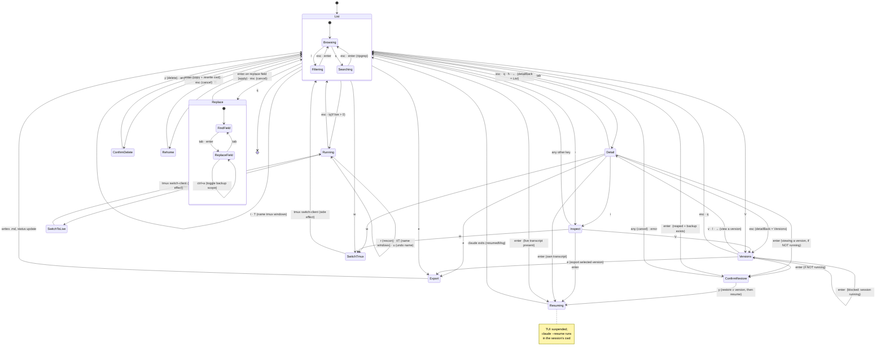

# claude-session-browser

A TUI for browsing and resuming [Claude Code](https://claude.com/claude-code) sessions across all your projects.

Claude Code stores every session as a `.jsonl` file under `~/.claude/projects/<project>/<session-id>.jsonl`. Its built-in `--resume` picker only shows sessions for the current directory — this tool shows all of them, sorted by recency, with titles, message counts, and models, and resumes any of them in the right working directory.

## Install

```sh
go install github.com/bdols/claude-session-browser@latest
```

or build from source:

```sh
go build -o csb .
```

## Usage

```sh
csb                 # launch the TUI
csb --list          # plain-text session table to stdout
csb --running       # list running Claude sessions (flags reaped ones) and exit
csb --export <id>   # render a session's transcript as Markdown to stdout
csb --commands      # audit every tool call across sessions (live + backups)
csb --root /path    # scan an alternate projects dir (see Remote below)
```

On terminals ≥95 columns wide the TUI shows a split view: the session list on the left and a live preview of the selected session's transcript tail on the right. Narrower terminals fall back to a full-width list.

The list shows two time columns: **MODIFIED** (time since the last message — the sort key) and **CREATED** (time since the first message). Both are derived from record timestamps, not file mtime. The inspect card (`i`) shows the exact start/end timestamps and span. When any visible session is running, a **CC VER** column appears showing each running session's Claude Code version (from the registry) — handy for spotting long-lived processes stuck on an old version.

### Keys

| Key | Action |
|-----|--------|
| `↑/↓` `j/k` | move selection |
| `enter` | resume selected session (`claude --resume <id>` in its original cwd; exiting Claude returns to the browser). If the session isn't in Claude's live dir but a backup exists (e.g. it was reaped, or you're browsing backups), a dialog offers to restore it first, then resume |
| `v` `l` `→` | view transcript |
| `i` | inspect: session id, start/end dates, duration, message/tool/token counts, running status, file size |
| `V` | browse stored backup versions of the selected session (view any version's transcript, restore-and-resume a specific one) |
| `R` | list currently-running Claude sessions, flagging ones whose transcript was cleaned up (rescue candidates); `enter`/`w` jumps to one |
| `e` | export the session's transcript to a Markdown file in the current directory (in the version browser, exports the selected version) |
| `c` | audit every tool call (Bash, Edit, Read, …) across all sessions, newest first, with `/` to filter and `enter` to jump to the owning session |
| `w` | switch the tmux window to the running session (if it's live and inside tmux) |
| `t` / `T` | name the selected session's tmux window after its project / name all of them (`u` in the running view undoes it) |
| `/` | filter (matches project, title, last prompt, branch, id) |
| `s` | full-content search across all sessions (uses `rg` when installed, Go fallback otherwise); shows per-session match counts, `esc` clears |
| `b` | back up sessions now |
| `m` | re-home the session into another directory (for a project that moved on disk) |
| `x` | find & replace literal text in the session — redacting a pasted secret, or fixing a stale path |
| `d` | delete session file (with confirmation) |
| `r` | rescan |
| `q` | quit |

The key bar sits on its own line at the bottom, so a search or filter readout never hides it — `i`, `w`, and the other actions stay listed and usable while a content search or filter is active.

### Running sessions

A marker in the left gutter shows sessions that are **currently running**, encoded by both shape and color so it stays legible under red-green color blindness (the palette avoids the green/red axis):

- `●` blue — idle but alive
- `◆` orange — busy (working)
- `▲` magenta — waiting on your input

The status bar shows a per-status breakdown (e.g. `●11 ◆2 ▲2 live`), which also serves as a legend, and the inspect card spells the status out in words.

Detection reads Claude Code's per-process registry at `~/.claude/sessions/<pid>.json` (which records the resolved session id, cwd, and status), drops stale entries whose process has exited, and walks the process's parents through `/proc` to find its tmux pane. Pressing `w` on a live session runs `tmux switch-client`/`select-window` to bring that pane to the foreground — the browser keeps running in its own pane. This works when the browser itself is running inside tmux.

### Rescuing reaped-but-running sessions

Claude Code cleans up a session's `.jsonl` after `cleanupPeriodDays`, but a **long-running process still holds the transcript in memory** — sending it any message rewrites the file. So a months-old running session whose file was reaped isn't lost, just invisible: no file means it never appears in the list, and if the process dies the transcript is gone for good.

`R` opens a running-sessions view listing every live Claude process with its status, PID, location (tmux window or cwd), and whether its transcript is `saved` or **`⚠ REAPED — rescue`** (reaped ones first). The main list also flags this: `⚠ N running with no saved transcript — press R`. To rescue one: `enter`/`w` to jump to its pane, send any message (e.g. "thanks") so Claude rewrites the file, then come back and `r` (rescan) + `b` (back up). `csb --running` prints the same list for scripting.

## Exporting to Markdown

Press `e` to export a session's transcript to a readable Markdown file (title, id, project, model, date range, then each user/assistant turn). It's written to the current directory. In the version browser, `e` exports the specific version you've selected — so you can export an older, more complete state.

```sh
csb --export <session-id> > session.md
```

`--export` picks the **most complete** transcript available for that id — the live file or the largest backup version — so a reaped session still exports its full history straight from backups. (This differs from Claude Code's own `/export`, which dumps only the current in-memory context — for a compacted session that's just the summary plus recent turns, not the full history that csb's backups retain.)

## Command / tool audit

Every command Claude runs is recorded in the transcript as a tool call, so csb can reconstruct a chronological audit of **everything Claude did** — Bash commands, file edits, reads, searches — across all your sessions. It reads from live sessions *and* the backup store, so reaped sessions are still covered.

Press `c` in the TUI for a searchable log (newest first; `/` filters; `enter` jumps to the owning session), or use the CLI:

```sh
csb --commands                 # full audit: TIME · PROJECT · TOOL · DETAIL
csb --commands git commit      # filter by term(s) — matches tool, detail, or project
csb --commands rm > audit.txt  # greppable / redirectable
```

This is a durable, atuin-style history of Claude's actions that survives Claude Code's 30-day transcript cleanup (because the backups do).

## Naming tmux windows after their project

Run several Claude sessions in tmux and every window is called `claude` or `zsh`, which tells you nothing about which is which. csb already knows the project behind each running session, so it can name the windows for you:

```sh
csb --name-windows --dry-run   # preview: WINDOW · FROM · TO
csb --name-windows             # apply
csb --name-windows --force     # include windows you named by hand
```

In the TUI, `t` names the selected session's window, `T` names all of them, and `u` (in the running view) hands a window back to tmux's automatic naming.

Windows are the unit, not sessions — several Claude processes often share one window, and tmux names windows. A shared window gets the projects joined with `+`, most recently active first.

Two rules keep this useful rather than merely tidy:

- **Names you chose yourself are left alone.** tmux records a manual rename as `automatic-rename off`, which is a reliable signal of intent — replacing a deliberate `jetson` with a generic project name is a downgrade. `--force` (or `t` on a single session, which is an explicit request) overrides it.
- **Ambiguous names get qualified.** Nine windows all named `obsidian` are no more informative than the `claude` they replaced, so when a project name would collide csb appends a short slug of the session's title: `obsidian-check-ebook`, `obsidian-evaluate-gemma`.

Renaming turns tmux's `automatic-rename` off for that window, which is what makes the name stick instead of reverting to the running command; `u` / `set-window-option automatic-rename on` reverses it. Re-running is a no-op when everything is already named correctly.

## Re-homing a moved project

Claude Code finds resumable sessions **only** in the directory derived from your *current* working directory: `/var/mnt/videos/Clips` becomes `~/.claude/projects/-var-mnt-videos-Clips`. Move or rename a project and its sessions stay behind under the old name — invisible from the new path, and absent from the resume/agents picker. Worse, if you move a directory out from under a *running* Claude, it notices, `chdir`s to `/tmp`, and every record it writes from then on claims the session lives in `/tmp`.

Nothing is lost in either case; the transcript is just filed under a name that no longer matches. `m` (or `--rehome`) files it correctly:

```sh
csb --rehome <id> --to /new/path/to/project
csb --rehome <id> --to /new/path --adopt-config   # also carry over trust/tools/MCP settings
```

It **copies** the transcript into the project directory for the new path (the original is left untouched), rewrites every record's recorded `cwd`, and brings the project's `memory/` directory along so the resumed session hasn't forgotten anything. With `--adopt-config` it also copies the old path's entry in `~/.claude.json` — `hasTrustDialogAccepted`, `allowedTools`, MCP servers — so you aren't re-approving a project you already trusted. Only keys missing at the new path are filled in; existing values always win. (Claude Code rewrites that file itself, so prefer running this while no session in either directory is live.)

An existing transcript at the destination is never overwritten without `--force`.

## Find & replace in a session

`x` (or `--replace`) runs a **literal** substitution across a session's transcript — for scrubbing a credential that got pasted into a chat, or correcting a path that changed:

```sh
csb --replace <id> --from 'sk-live-…' --to '[REDACTED]' --all-versions
```

Every modified record is re-parsed as JSON before anything is written, so a replacement that would corrupt the transcript (an unescaped quote landing inside a string) fails and leaves the file alone.

`--all-versions` matters for redaction: a secret scrubbed from the live file **still sits in the backup version history**, so csb's own durability would otherwise work against you. With the flag, csb rewrites every stored version and re-seals each one's filename hash to match its new content, keeping version dedup honest. The TUI has this on by default (`ctrl+a` toggles it) and reports how many files it touched. Without it, csb tells you the versions still contain the original text.

### Environment

| Variable | Effect |
|----------|--------|
| `CSB_CLAUDE_BIN` | `claude` binary used for resuming (default `claude`) |
| `CSB_TMUX_SOCKET` | tmux server socket (`tmux -L <name>`) for detection and switching; default server otherwise |

## Backups

Claude Code deletes session transcripts older than `cleanupPeriodDays` (default: **30 days**). The browser keeps **versioned, append-only** copies under `~/.local/share/claude-session-browser/backups/` (or `$XDG_DATA_HOME/...`) automatically on every launch, so any session you've browsed at least once in 30 days survives the purge.

Backups are **append-only**: each launch captures the session's current content as a new immutable version *only when it changed*, and versions are never overwritten or deleted. This is deliberate — a mirror that overwrites can propagate a truncated or corrupted source over a good backup and destroy it; a versioned store cannot. A truncation just lands as a smaller *new* version beside the good one.

Layout, per session file:

```
<project>/<id>.jsonl            # "current" file (hard link to the newest version) — browsable via --root
<project>/<id>.versions/        # append-only history, one file per distinct state
    20260801T120000-ab12cd.jsonl
    20260801T153000-9f0e11.jsonl
```

```sh
csb --backup                    # one-shot sync (for cron/systemd timers)
csb --backup-dir /path          # alternate destination
csb --no-auto-backup            # don't sync on TUI launch
csb --root ~/.local/share/claude-session-browser/backups   # browse the backups themselves
csb --restore <session-id>      # restore the most complete version so --resume works again
```

`--restore` brings back the **most complete (largest) version**, so a later truncation can never mask the good copy, and it refuses to overwrite a session that still exists live. The inspect card (`i`) shows how many versions are stored and flags (`⚠`) when an older version holds more data than the newest — the sign of a truncated live file. Existing pre-versioning (flat) backups are migrated in place on the next sync: the old copy is seeded as version 1 before anything else is captured. You can also raise `cleanupPeriodDays` in `~/.claude/settings.json` to keep the originals longer.

### Browsing versions (`V`)

Press `V` on any session to open its version browser: every stored version, newest first, with its timestamp, size, and record count, plus flags for the **most complete** (`★`) and the one matching the **current live** file (`●`). From there:

- `v` / `→` — view that version's transcript in the reader.
- `enter` — restore that specific version and resume it. If a live transcript already exists, it's captured as a version *first*, so going back to an older state is itself reversible — nothing is ever lost.
- `w` — switch to the session's tmux window (if it's running).
- `esc` — back to the list.

Restoring a version is **blocked while the session is running** — overwriting a live transcript would be clobbered by the running process on its next save. The browser flags this (`⚠ session is running — restoring a version is disabled`); switch to it with `w` and stop it first. Viewing a version's transcript is always allowed.

This is how you resume an *earlier* state rather than the most-complete default: pick the version you want and press `enter`. `--no-auto-backup` only disables the on-launch sync now; it no longer forgets the backup location, so restore/version browsing still works with an explicit `--backup-dir`.

## Remote sessions

There is no server component (yet). To browse sessions on a remote machine, mount or sync its projects dir and point `--root` at it:

```sh
sshfs server:.claude/projects /tmp/remote-sessions
csb --root /tmp/remote-sessions
```

Resuming a remote session locally only makes sense if the project cwd exists locally too; otherwise use the browser for reading transcripts.

### Roadmap

- atuin-style sync: a small server storing session summaries from many machines, with the TUI browsing all of them and `ssh <host> claude --resume <id>` to jump in
- token/cost stats per session

## Testing

```sh
go test ./...        # unit tests: parsing, backup sync/restore, search (rg + Go fallback)
test/tui_test.sh     # end-to-end TUI tests driven through tmux (requires tmux)
```

The Go tests build their own fixtures in temp dirs — including the running-session detection (fake registry via `CSB_SESSIONS_DIR`, injected process/pane data) and the tmux switch, which runs against a private throwaway tmux server via `CSB_TMUX_SOCKET` so it can never disturb your own session. `test/tui_test.sh` builds the binary, runs it against a throwaway fixture projects dir with `claude` stubbed via `CSB_CLAUDE_BIN`, and drives real keystrokes to assert on rendered output (split-pane preview, filter, inspect, content search, resume hand-off). Neither suite touches your real `~/.claude/projects` or tmux server.

## How it works

Each `.jsonl` line is a typed record (`user`, `assistant`, `ai-title`, `last-prompt`, …). The scanner does a partial JSON decode of every line to extract the title, cwd, git branch, model, timestamps, and human/assistant message counts, skipping meta records, sidechains, and tool results. The transcript view re-parses the file into user prompts, assistant text, and one-line tool-call summaries.

Running-session detection is separate: Claude Code maintains `~/.claude/sessions/<pid>.json` for each live process, giving an exact session id regardless of how it was launched. The browser reads that registry, validates each pid against `/proc` (dropping stale files and guarding pid reuse), and walks parent pids until it reaches a tmux pane to locate the window.

### UI state machine

The TUI is a mode-based state machine (`internal/ui/ui.go`). `enter` is polymorphic — it resumes a live session, restores-then-resumes a reaped one, or restores a chosen version — and version restores are blocked while the session is running (the self-loops below).



`List` is the hub; `Filtering`/`Searching` are input overlays within it. `Resuming` isn't a UI mode — `tea.ExecProcess` suspends the TUI to run `claude --resume`, and `resumedMsg` returns to `List`. `SwitchTmux`/`SwitchToLive` and `Export` are side-effects that don't change the logical state.
